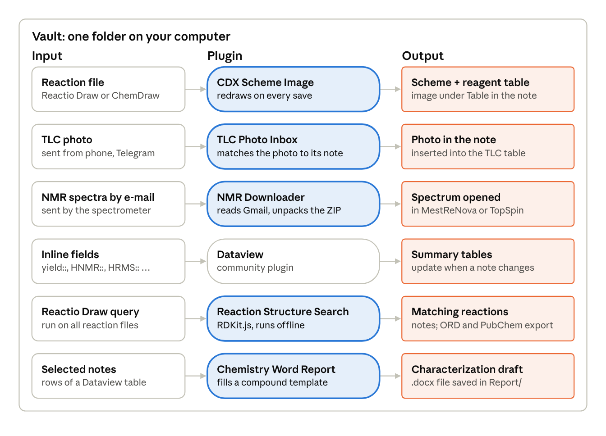
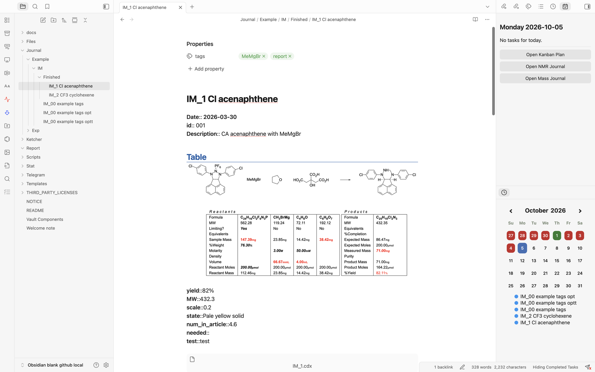
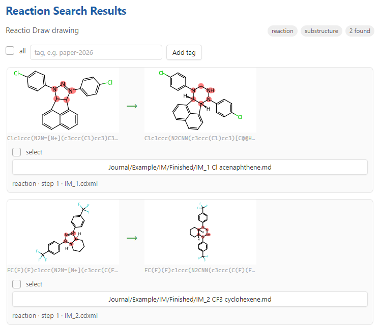
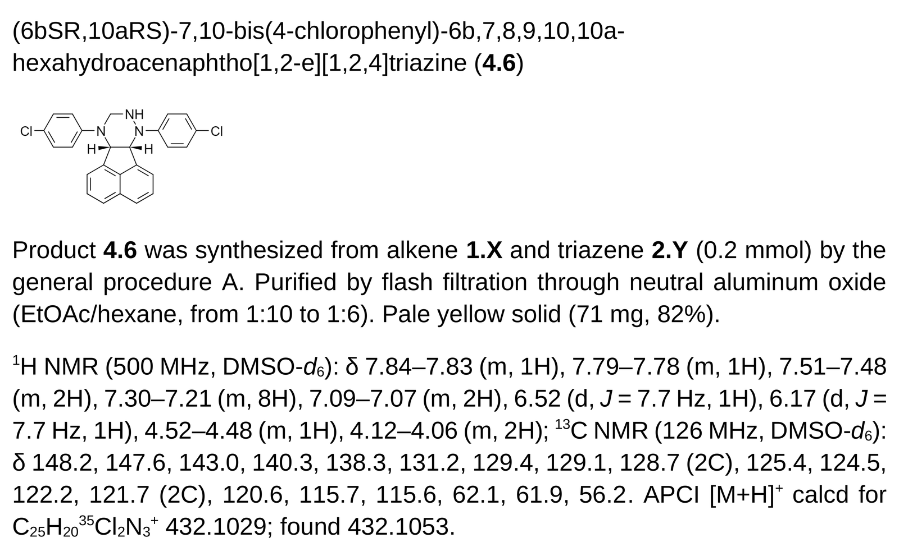

<h1 align="center">Chemistry Lab Notebook for Obsidian</h1>

<b>An electronic lab notebook for synthetic chemistry that keeps all data on your own computer — from reaction notes to a Supporting Information draft.</b>

  
  
  
  

  <a href="#screenshots"><b>Screenshots</b></a> •
  <a href="#main-features"><b>Features</b></a> •
  <a href="#installation"><b>Installation</b></a> •
  <a href="Welcome%20note.md"><b>User guide</b></a> •
  <a href="#citation"><b>Citation</b></a>

A chemistry electronic laboratory notebook (ELN) based on Obsidian and distributed as a ready-to-use vault. The complete vault can be downloaded and used with little or no configuration beyond installing Obsidian and enabling the included plugins. Python and a separate chemical-search backend are not required.

The project combines configured open-source community plugins, purpose-built plugins developed for this workflow, reusable templates, and helper scripts that simplify routine laboratory-journal work. It can be adopted as a complete ELN or used modularly: laboratories may reuse individual plugins, templates, scripts, or parts of the workflow in an existing Obsidian vault. The workflow connects reaction records, analytical data, planning, chemical-structure searching, reagent databases, and external chemistry software while keeping the research files under the user's control.

*Inputs and outputs of six plugins of the vault; plugins written for this notebook are highlighted.*

## Screenshots

**Reaction note.** A reaction note in Obsidian with tags, the reaction scheme and reagent table, and inline fields used by Dataview tables. The vault structure is on the left; the daily Kanban tasks and the note-activity calendar are on the right.

**Structure and reaction search.** A structure or reaction drawn in Reactio Draw is matched against the reaction files (`.cdx` or `.cdxml`, from Reactio Draw, ChemDraw or other editors) of all reaction notes; matched atoms are highlighted and each hit opens the corresponding note.

**Supporting Information draft.** Chemistry Word Report assembles compound names, structures, yields, and analytical data from the selected notes into an editable Word document. The procedure sentence and the starting-material numbers (1.X, 2.Y) are template text, which the chemist checks and completes.

Full examples: [reaction note exported to PDF](docs/examples/reaction%20note%20example.pdf) and [generated Supporting Information draft (DOCX)](docs/examples/Draft%20SI.docx).

## Why use this ELN?

- **Automatic ACS-style Supporting Information drafts.** The Chemistry Word Report plugin assembles selected compound descriptions, experimental and analytical data, and structure images into a formatted Word document that can be used as a draft of ACS-style Supporting Information.
- **Your data stays local.** Notes and experimental files are stored locally. The project does not require a hosted ELN service or central database. Backup and synchronization are optional and are selected, configured, and controlled by the user.
- **Work in familiar chemistry software, or in free software.** Reactions are drawn in Reactio Draw, a free open-source editor that opens inside Obsidian (a click on the picture under **Table** of a new note), or in ChemDraw as usual; NMR spectra are processed in MestReNova, Bruker TopSpin or any other program. The notebook links to the native files instead of replacing them. Either way the reaction file is CDXML or CDX, and the reaction scheme and reagent table appear in the reaction note automatically each time the file is saved.
- **Standard data export for publication.** Selected reactions, including failed ones, can be exported as an Open Reaction Database (ORD) dataset with structures, amounts, conditions, yields and analyses taken from the reaction files (`.cdx` or `.cdxml`, from Reactio Draw or ChemDraw) and notes.
- **Familiar paper-notebook layout.** Each reaction is a single page arranged like an entry in a paper lab notebook — reaction scheme and reagent table, procedure, observations, and analytical data — so it is easy to understand where everything is and how the notebook is organized.
- **Full customization.** Notes, metadata fields, templates, tables, scripts, interface elements, and plugins can be adapted to the requirements of an individual researcher or laboratory.
- **Open workflow components.** The plugins and scripts distributed with this vault are open source, and their licenses are documented. Obsidian is free for personal, commercial, educational, and nonprofit use, but the application itself is proprietary and not open source.
- **Straightforward PDF export and printing.** Experiment records can be exported to PDF or printed at any time, allowing the journal to be archived, shared, reviewed, or transferred to a paper-based workflow.
- **Reaction-note templates.** Reusable templates provide a consistent structure for reagents, quantities, conditions, observations, workup, purification, yields, and analytical data.
- **Automatically assembled tables.** Dataview-based tables collect information from individual notes to produce reaction scopes, optimization tables, sample journals, task lists, and other summaries without duplicating the underlying data.
- **One-click access to experimental data.** A reaction note can link directly to associated processed or original data, such as a MestReNova file, a spectrum PDF, a structure drawing, an image, or another analytical file.
- **Integration with reagent databases.** Individual reagents in a reaction note can link directly to their records in an inventory or reagent database, such as LabSuit. This provides one-click access to the exact reagent entry and the information maintained by the laboratory.
- **Multiple ways to search the journal.** Experiments can be found by ordinary full-text search, tags and metadata, or chemical structure. Structure search supports individual compounds as well as exact and substructure reaction queries.
- **Traceable links between experiments.** A reaction note can cite the earlier experiment in which a starting material was prepared. Obsidian links and backlinks make it easy to follow the experimental history and determine how many subsequent reactions used a particular prepared batch of material.

## Main features

- Automatic generation of editable DOCX drafts for ACS-style Supporting Information from selected reaction notes and Dataview tables.
- Automatic reaction images: when a reaction file from Reactio Draw or ChemDraw is saved, its reaction scheme and reagent table are drawn with the file's own drawing settings and inserted into the matching reaction note.
- Structured reaction notes with reagents, quantities, conditions, yields, observations, TLC, NMR, and MS information.
- Direct links to structure drawings, spectra, PDFs, images, and other analytical files stored in the vault. The example notes use reaction files drawn in Reactio Draw (`.cdxml`; ChemDraw `.cdx` files work the same way) and links to MestReNova (`.mnova`) files, which are not included; these formats are not required.
- Links from reaction-note reagent entries to specific records in external inventory or reagent databases, including LabSuit.
- Local structure and reaction searching with Reactio Draw and an embedded RDKit.js engine; no Python installation or network connection is required.
- Exact and substructure searches for individual compounds and reaction participants.
- Reaction queries with both sides, reactants only, or products only.
- Full-text, tag, metadata, and structure-based retrieval across the journal.
- Links and backlinks between preparation and use experiments for tracking the provenance and reuse of specific material batches.
- Dataview summary tables for reaction scope, optimization, unfinished work, recent notes, NMR, and mass-spectrometry samples.
- Kanban-based planning and custom journal controls.
- Telegram-assisted transfer of photographs and notes from a phone.
- Templates and scripts for consistent experiment identifiers and journal entries.
- A complete example dataset demonstrating the workflow.

## Installation

1. Install [Obsidian](https://obsidian.md/) 1.14 or later (desktop app; several of the included community plugins — QuickAdd, Templater, Meta Bind, Dataview Serializer — do not run on versions before 1.13).
2. Download `Chemistry-Lab-Notebook-vX.Y.Z.zip` from the latest release of this repository (*Releases* on the repository page; every release is also archived on Zenodo) and extract it to a local folder, OneDrive, or another synchronized location. *Code → Download ZIP* gives the same vault with changes not yet released.
3. Open the extracted folder as an Obsidian vault.
4. When prompted, trust the vault and enable the included community plugins.
5. Read [Welcome note.md](Welcome%20note.md) for the illustrated workflow guide and [Vault Components.md](Vault%20Components.md) for a description of every script, CSS snippet, and plugin used in the vault.

The required plugin folders and their settings are included in the vault. The only exception is the settings file of NMR Downloader, which is excluded from the repository because it holds personal folder paths. The Google sign-in of NMR Downloader and the Telegram bot token are kept only on your computer (Obsidian's local storage, encrypted by the operating system where available), never in the vault.

### Updating an existing vault

An update replaces program files only; your notes and settings stay. Plugins from the community directory update in *Settings → Community plugins → Check for updates*; the notebook's own plugins do so once they are listed there, and until then from the `Plugins-update-vX.Y.Z.zip` archive of each release. Changed templates, scripts and notes are listed in [CHANGELOG.md](CHANGELOG.md). Step by step: [docs/updating.md](docs/updating.md).

### Plugins developed for this workflow

- **Chemistry Word Report** generates an editable DOCX report from the reaction notes listed by the Dataview query in the active note (run through the Dataview API) or by a hand-written table of note links. It reads the linked reaction notes, applies a configurable compound-description template, inserts available structure images and analytical data, and saves the report in the selected output folder. Report generation runs locally and does not require Python, npm, Microsoft Word, or an internet connection. Dataview is required for reports from a Dataview query (not for a hand-written table of links).
- **Reaction Structure Search** searches the local reaction files (`.cdx` or `.cdxml`, from Reactio Draw, ChemDraw or other editors) using a structure or reaction drawn in Reactio Draw. It supports exact (optionally stereo-aware: relative or absolute configuration) and substructure searches, individual structures, multicomponent reactions, reactant-only and product-only queries, role filtering, incremental indexing, and highlighted matches; result notes can be ticked and tagged in one step. It also exports selected reactions as an [Open Reaction Database](https://open-reaction-database.org) (ORD) dataset — structures, amounts and roles from the reagent table of the reaction file, conditions, yields and analyses — including failed reactions, and prepares PubChem deposition files (SDF + PubChem CSV) for the products of a paper, linked to its DOI. Its RDKit.js chemistry engine is embedded in the plugin and runs locally without Python or network access; chemical abbreviations (labels ChemDraw could not interpret, reagents written as text next to the arrow) are resolved with the open BChemLookup table of the Beilstein-Institut (Bänsch, Rajan, Nietfeld, *ChemRxiv* 2026, [DOI 10.26434/chemrxiv.15010166/v1](https://doi.org/10.26434/chemrxiv.15010166/v1)). Reactio Draw is required for drawing the query, Dataview for the exports from a Dataview table.
- **CDX Scheme Image** (formerly ChemDraw Scheme Image) keeps each reaction note synchronized with its reaction file (Reactio Draw or ChemDraw): whenever a `.cdx` or `.cdxml` file is saved, it draws the reaction scheme and the reagent table with the drawing settings saved in the file (such as ACS Document 1996) and inserts the image under **Table** in the matching reaction note; when the reaction has a single product, the product structure is also saved as a PNG and placed in the note's `pic::` field used by Chemistry Word Report, a picture with its formula, exact mass and m/z (as in ChemDraw's Analysis window) goes into `Mass_pic::` for the HRMS request, and its yield, measured mass and molecular weight from the reagent table are written into `yield::`, `mass::` and `MW::` (updated when the table changes, a number the plugin wrote is cleared when the value is removed; a number of unknown origin and text typed by hand are kept); reaction conditions from a *Temperature / Time / Atmosphere / Other* caption go into `temperature::`, `time::`, `atmosphere::` and `other::`. Files from Reactio Draw (`.cdxml` or `.cdx`) are drawn with its Reactants, Products and Conditions tables. Drawing runs locally and does not require ChemDraw. Desktop only.
- **Kanban Day Planner** (formerly Kanban Planner Custom) provides the automated weekly planning workflow used by the example vault.
- **NMR Downloader** downloads NMR spectra archives that the NMR service sends by e-mail (Gmail, with Google sign-in), unpacks them into folders sorted by spectrometer frequency (or into one folder, or both), and opens the spectra in MestReNova or Bruker TopSpin (in TopSpin each experiment of a sample in its own window, TopSpin started when closed). An **Open in TopSpin** button in the NMR section of a reaction note opens the spectra listed in its `NMR_id` field. It is the only component besides the Telegram bot of TLC Photo Inbox that connects to an online service, and only when you run it. See the [NMR Downloader guide](NMR%20Downloader%20guide.md).
- **Reactio Draw** opens the [Reactio Draw](https://github.com/Paivel/reactio-draw) editor (free, MPL-2.0; version 1.15.2 is included) in an Obsidian tab to draw structure and reaction search queries and your own schemes. A scheme goes into a note as a `.rdraw` file (a picture with the drawing inside); the note shows the picture, and a click on it opens the drawing for editing. For a reaction note, a click on the picture *Click to draw the reaction and the reagent table* under **Table** creates `Files/A_122.cdxml` (named after the note) and opens it; Ctrl/Cmd+S or Ctrl/Cmd+W saves it and closes the tab, and CDX Scheme Image puts the scheme with its tables, the MW, the yield and the conditions into the note. ChemDraw `.cdx` files keep opening in ChemDraw. Reactio Draw documents (`.reactio`) in the vault open in the tab from their context menu and are saved in place. Structures from names (common and systematic names, CAS numbers) work in the tab; the IUPAC name of a drawn structure needs the installed Reactio Draw app (Windows, Mac, Linux).
- **Template Guard** keeps the structure of reaction notes: template headings, field labels, tables and buttons are protected while editing, missing parts are found and restored, and fields added to a project template are offered for the existing notes of that project. See the [Template Guard guide](Template%20Guard%20guide.md).
- **TLC Photo Inbox** (formerly Telegram TLC Image) connects your own Telegram bot to the vault: the bot lists the latest reactions to choose from and files the photos sent for the chosen one into its TLC table; other messages (text, links, PDF and other files) become notes in the **Telegram** folder.

The Filename Heading Sync plugin is configured to rename only notes inside `Journal/`, so that documentation files such as this README keep their names.

### Modified plugin

The vault includes one modified build of a published plugin: Chronology Custom (the calendar can count the notes of one folder only, and the calendar looks different). It does not receive updates from the Obsidian Community Plugins store under its own id; the original Chronology plugin preserves only part of the functionality used by this workflow and has a different appearance. Kanban is the unmodified published plugin.

## Chemistry plugin setup

For **Reaction Structure Search**, open its settings and select the folder containing the Markdown reaction notes and the folder containing the `.cdx`/`.cdxml` reaction files (the ORD and PubChem exports look for reaction files in this folder too). The local JSON index is created automatically in `.reaction-index` and does not need to be committed.

For **CDX Scheme Image**, the defaults match the example vault: `.cdx` or `.cdxml` files in `Files/`, reaction notes in `Journal/`. Keep one ChemDraw file per reaction: if both `A_141.cdx` and `A_141.cdxml` exist, both plugins use the newer one and show a warning. Existing notes are not changed when the plugin is first enabled (only ChemDraw files saved after that are drawn automatically): an image is drawn when the `.cdx` file is saved again, or with the command **Update scheme image in current note**. The blank `Open CDX Editor.cdx` linked from the templates is excluded in the plugin settings.

For **Chemistry Word Report**, select the reaction-note folder, report output folder, and image folder in the plugin settings. Open a note containing a Dataview query (or a table of note links) and run the plugin from the ribbon or Command Palette. The first link to a note in each row is used.

For the **ORD export** (Reaction Structure Search), enter your name and e-mail under *ORD export* in the plugin settings (both are required, and the e-mail becomes public with the dataset; these details are stored only on your computer, not in the vault). Then run **Export ORD dataset from current table** in a note with a Dataview query of reaction notes, or **Export current note to ORD** in a reaction note. The dataset is written to a new numbered folder `Export/ORD/1/`, `2/` … as protobuf JSON (optionally also `.pbtxt`); a report lists the exported reactions, warnings and errors per note. Fill in `temperature::`, `time::` and `atmosphere::` in the notes (now part of the templates) so that conditions are exported; failed reactions (`yield:: 0`, `n.r.`, `traces`) are exported too; `yield:: n.d.` means not determined. Notebook codes (ChemDraw file and note names) are not written unless *Include notebook codes* is switched on. Reagents written as text above the arrow are exported when the name is in BChemLookup and the amount is written next to it, e.g. `Et3N (2 equiv), THF (2 mL)` (equivalents are converted with `scale::`). Amounts and the other values (mass, volume, molarity) are taken from the reagent table, also for reagents written as text in Reactio Draw, which keeps them in its table. Catalyst and solvent roles chosen in the reagent table of Reactio Draw are used; all other roles are assigned automatically, as for ChemDraw files; they are listed in the export report; to set one yourself, add a line such as `roles:: MeMgBr = reactant; C6H8O7 = workup` to the note, using the names shown in the report (`workup` exports a quench added after the reaction, here citric acid, as a workup step instead of a reaction input). Structures are exported with the stereochemistry drawn with wedges; racemates named as such (`rac-`, `(±)`, `(…RS,…SR)`) are marked as racemic, `rel-` as relative configuration.

For the **PubChem export**, set a registry-ID prefix (e.g. a lab code) under *PubChem export* in the plugin settings, then run **Export products to PubChem from current table** in the same kind of note with a Dataview table. Every product needs its compound number in `num_in_article::` (several products of one note: `4a, 4b`): the registry IDs are built from the prefix, the paper DOI and this number. Enter the paper DOI (and optionally a *hold until* date), check the draft table and export: a new numbered folder `Export/PubChem/1/`, `2/` … receives an `.sdf` to upload yourself in PubChem Submissions (New Submission → Substances), the same records as a PubChem spreadsheet (`_pubchem.csv`), and a `.tsv` for checking. Upload the `.sdf`: it keeps the drawn structure; in the spreadsheet a racemate is given as an InChI with `/s3` instead of a SMILES (PubChem accepts SMILES, InChI or CID as the structure). Only the products are exported; the plugin makes no network requests.

All note parsing, chemical indexing, structure queries, Word-report generation and the ORD and PubChem exports remain local; the files are only written to your vault, never uploaded.

## Platform notes

The vault has been tested on Windows and macOS. Linux has not been tested.

Better Export PDF, CDX Scheme Image, Chemistry Word Report, NMR Downloader, Reactio Draw, Reaction Structure Search, and Webpage HTML Export are desktop-only plugins; the Telegram bot of TLC Photo Inbox also runs only in the desktop app. The vault can be opened in Obsidian Mobile to read and edit notes, but these functions are available only on a desktop computer. Telegram messages are imported when the desktop Obsidian app is running (Telegram keeps them for 24 hours).

The Excel printing automation in `Templates/add_mass.md` is Windows-only because it uses PowerShell and Microsoft Excel COM automation. It uses the request-form template `Files/MS_FORM.xlsx`, which must be adapted to your mass-spectrometry facility. Other mass-journal functions remain ordinary Obsidian content.

ChemDraw, MestReNova and TopSpin are optional external applications, not requirements. Spectra may be stored and linked in any suitable format produced by other processing software, including PDFs, images, exchange formats, or original data files.

ACD/ChemSketch can be used instead of ChemDraw. Its structure files can be linked to the experiment, and its reagent-calculation table can be captured and inserted into the reaction note in the same way as a ChemDraw table. Automatic example links use `.cdx` and `.mnova` filenames, but users can add links to any other file type or adapt the templates to their preferred software.

## Telegram configuration

Telegram is only one suggested way to transfer photos from a phone and is optional. Alternatively, you can use the OneDrive mobile app (or another cloud storage app): upload the photo to a folder that is synchronized with your computer, or directly to the vault's **Files** folder if the vault itself is stored in OneDrive, and then drag or paste the image into the reaction note in Obsidian on the computer. In this case the image is inserted manually; automatic insertion into the TLC table works only through the Telegram workflow.

The distributed vault does not contain a bot token. To use Telegram, create your own bot and connect it once:

1. **Create a bot.** In Telegram, open [@BotFather](https://t.me/BotFather), send `/newbot`, enter a display name for the bot, and then a username that ends in `bot` (for example, `my_lab_journal_bot`). BotFather replies with a **bot token** such as `6123456784:AAX9mXnFE2q9WahQ…`. Keep the token private: anyone who has it can control the bot.
2. **Connect the bot.** In Obsidian on your computer, open **Settings → TLC Photo Inbox**, paste the token into **Bot token**, click **Apply** and switch on **Enable the bot**. The token is stored only on this computer, not in the vault.
3. **Pair your Telegram account.** Under **Pair your Telegram account**, click **Show code** and send `/start <code>` to your bot within 10 minutes. The bot answers only paired accounts.
4. **Optional: set a default project.** With **Default project** set to your project code (for example, `A`), a photo caption `35` means reaction `A_35`. The rest of a caption (`35 Rf 0.3, hexane/EtOAc 3:1`) is written under the photo in the same cell of the TLC table.
5. **Test it.** In the bot, press **📋 Reactions**, choose a reaction from the list and send a photo. While Obsidian is running on your computer, the photo is saved, removed from the chat and, after you confirm, inserted into the TLC table of that reaction note.

Everything else sent or forwarded to the bot (a photo without a chosen reaction, text, a link to a paper, a PDF or another file) becomes a note in the **Telegram** folder (`Telegram/2026-10-16-1.md`) with links to the attachments, which are saved in **Files**. See also [Vault Components.md](Vault%20Components.md#telegram-tlc-image).

## Repository structure

- `.obsidian/` — Obsidian settings, plugins, and CSS snippets.
- `Journal/` — reaction and project notes.
- `Templates/` — Templater and journal templates.
- `Stat/` — summary tables, journals, planning boards, and reports.
- `Files/` — linked structures, spectra, PDFs, and images, including reaction-scheme images generated from the reaction files.
- `Report/` — output folder for Supporting Information drafts generated by Chemistry Word Report.
- `Export/ORD/` — ORD datasets written by Reaction Structure Search, one numbered subfolder per export (created on first export).
- `Export/PubChem/` — PubChem deposition files written by Reaction Structure Search, one numbered subfolder per export (created on first export).
- `Drawings/` — drawings saved from Reactio Draw as CDXML (created when you first save one; not searched by Reaction Structure Search).
- `Telegram/` — notes made by the Telegram bot from messages sent to it.
- `Scripts/` — helper scripts used by templates.
- `docs/` — screenshots used in this README (`docs/images/`) and full example outputs (`docs/examples/`).
- `THIRD_PARTY_LICENSES/` — third-party attribution, license texts, and upstream sources.
- `Welcome note.md` — illustrated user guide.
- `Vault Components.md` — description of every script, CSS snippet, and plugin used in the vault.
- `CHANGELOG.md` — what changed in each release; `docs/updating.md` — how to update an existing vault.
- `.github/workflows/release.yml` — builds the two archives of a release when a version tag (`v1.0.0`) is pushed.

## License

Original code, scripts, templates, documentation, configuration, and workflow material authored for this project are licensed under the MIT License; see [LICENSE](LICENSE).

Third-party plugins and bundled components retain their own licenses. They are not relicensed under the project MIT License. See [NOTICE.md](NOTICE.md), [THIRD_PARTY_LICENSES/SOURCES.md](THIRD_PARTY_LICENSES/SOURCES.md), the upstream license files in `THIRD_PARTY_LICENSES/licenses/`, and the license files shipped with the modified plugin.

Not affiliated with or endorsed by Dynalist Inc. (Obsidian) or Revvity Signals Software, Inc. (ChemDraw). Obsidian and ChemDraw are trademarks of their respective owners.

## Use of AI tools

AI assistants (Claude by Anthropic and ChatGPT by OpenAI) were used during the development of this project, including help with writing and debugging the code of the custom plugins. All AI-assisted output was reviewed, tested, and edited by the author.

## Citation

If this workflow contributes to research or a publication, please cite it using the metadata in [CITATION.cff](CITATION.cff). GitHub can display the recommended citation automatically.

## Author

Pavel Sakharov, Technion – Israel Institute of Technology
